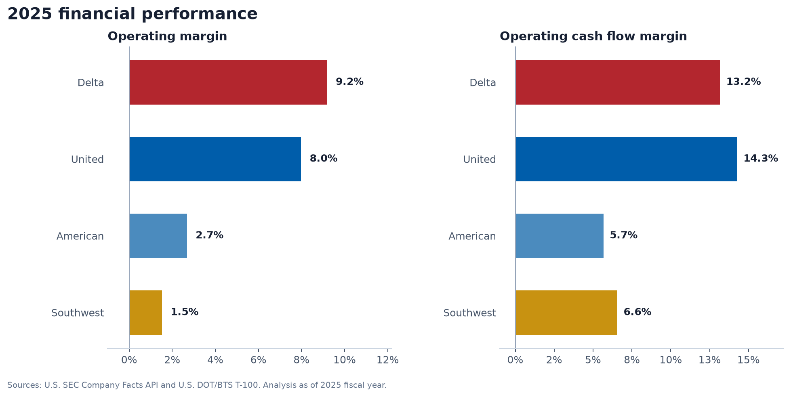
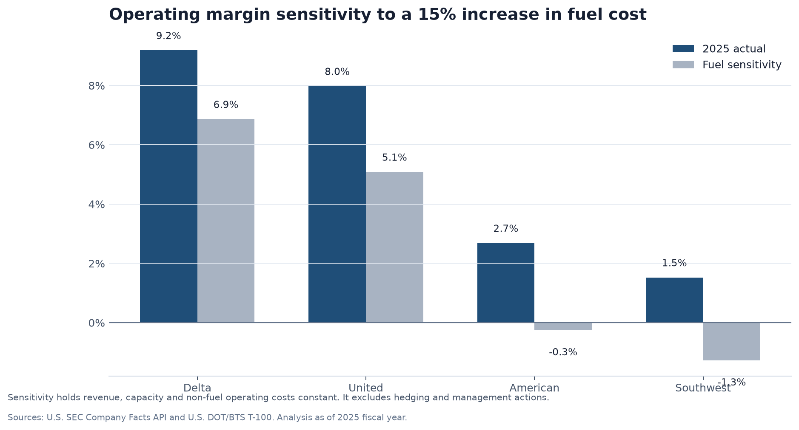

# U.S. Airline Strategic Finance & Operations Intelligence

An independent analysis of how American Airlines, Delta Air Lines, Southwest Airlines and United Airlines converted traffic and capacity into financial performance from 2019 through 2025.

The project combines regulatory financial statements with operating data reported to the U.S. Department of Transportation. It was built to answer a management question:

> Which carriers have the strongest financial resilience, and how exposed are their margins to a change in fuel cost or passenger demand?



## Executive conclusions

- **Delta led 2025 operating profitability.** Revenue was $63.4 billion and operating margin was 9.2%. Fuel cost represented 15.5% of revenue, the lowest share in the peer group.
- **United led operating cash generation.** Its operating cash flow margin was 14.3%, compared with 13.2% at Delta.
- **American retained the highest balance-sheet exposure.** Net debt was $24.2 billion and operating margin was 2.7%.
- **Southwest remained below peers on utilization and margin.** Load factor was 74.4% and operating margin was 1.5%.
- All four carriers generated more revenue than in 2019, but none recovered its 2019 operating margin.

## Fuel-cost sensitivity

The sensitivity below increases reported 2025 fuel cost by 15% while holding revenue, capacity and non-fuel operating costs constant. It excludes hedging, pricing responses and management actions.



Under this narrow sensitivity, American and Southwest move into an operating loss. Delta and United retain positive operating margins.

## Deliverables

- **Excel decision model:** executive summary, peer comparison, scenario selector, actuals, audit checks and methodology.
- **SQLite analytical database:** annual financial and operating performance, monthly operations and quarterly fare observations.
- **SQL analysis:** peer ranking, recovery versus 2019, monthly capacity utilization, fuel sensitivity and source-coverage checks.
- **Python pipeline:** downloads official files, standardizes SEC facts, builds the analytical tables and produces the figures.
- **Executive memo:** findings and management implications in a concise written format.

[Open the Excel model](reports/airline_strategic_finance_model.xlsx)  
[Read the executive memo](reports/executive_memo.md)  
[Review the SQL analysis](sql/analysis.sql)

## Data sources

| Source | Use | Coverage |
|---|---|---|
| [SEC Company Facts API](https://www.sec.gov/search-filings/edgar-application-programming-interfaces) | Revenue, operating income, net income, operating cash flow, fuel cost, cash and debt | Forms 10-K, 2019–2025 |
| [DOT/BTS T-100 carrier summary](https://catalog.data.gov/dataset/aff-t100-segment-summary-by-carrier) | Passengers, seats, departures and domestic/international traffic | Monthly, 2019–2025 |
| [DOT/BTS average fare by carrier](https://catalog.data.gov/dataset/aff-average-air-fare-by-carrier) | Reported domestic market fares and yield | Quarterly, 2019–2024 |

The raw files are not committed. `src/download_sources.py` retrieves them from the official endpoints.

## Analytical model

```text
SEC Company Facts ─┐
                   ├─ Python validation and normalization ─ SQLite / CSV
DOT/BTS T-100 ─────┤                                      ├─ SQL analysis
DOT/BTS fares ─────┘                                      ├─ Excel model
                                                          └─ Figures and memo
```

Key measures:

- operating margin;
- operating cash flow margin;
- fuel cost as a percentage of revenue;
- net debt;
- passenger load factor;
- international passenger share;
- revenue and margin change versus 2019.

## Repository structure

```text
data/
  processed/                   analysis-ready CSV files and quality report
  airline_intelligence.sqlite  analytical database
docs/
  methodology.md               definitions, source hierarchy and limitations
reports/
  figures/                     publication-style figures
  airline_strategic_finance_model.xlsx
  executive_memo.md
sql/
  analysis.sql
src/
  download_sources.py
  build_dataset.py
  create_figures.py
tests/
  test_data_quality.py
```

## Reproduce the analysis

```bash
python -m venv .venv
source .venv/bin/activate
pip install -r requirements.txt

export SEC_USER_AGENT="your-name your-email@example.com"
python src/download_sources.py
python src/build_dataset.py
python src/create_figures.py
python -m unittest discover -s tests
```

The SEC asks automated clients to identify themselves in the request header. Set `SEC_USER_AGENT` before downloading the Company Facts files.

## Data-quality decisions

- Annual SEC facts must come from a Form 10-K fiscal-year observation with a duration between 300 and 400 days.
- Ticker-year combinations must be unique.
- Load factors outside 0%–100% fail validation.
- Missing values remain missing. They are not replaced with zero.
- The DOT fare dataset shows a material coverage break in reported market-passenger counts beginning in 2025 Q3. Fare analysis therefore stops at 2024 until the source methodology is confirmed.
- The project does not estimate route-level profitability because public data do not provide a reliable route-level cost allocation.

## Limitations

This is an independent analysis based on public information. It is not company guidance or investment advice. The sensitivity cases isolate specific changes and do not predict management behavior.

